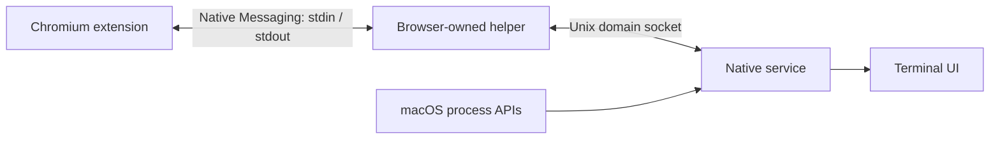

# How Argus maps browser pages to OS processes

Argus combines two views of a browser: page identities from an extension, and resource accounting from macOS. The design originated in the [browser-performance investigation](https://joeshang.github.io/investigation-of-getting-browser-tab-performance/). This document explains its central idea and how the current implementation applies it.

## The missing link: renderer identity

A browser tab ID identifies a UI object. macOS CPU and memory counters identify a process. These identifiers belong to different namespaces, so a tab ID cannot be used directly as an OS PID.

Chromium supplies a useful bridge:

1. The extension enumerates tabs and calls `chrome.webNavigation.getAllFrames()` to obtain each frame's URL, document ID, and renderer `processId`.
2. The native service enumerates browser subprocesses and reads their launch arguments, including `--renderer-client-id`.
3. Matching these renderer identifiers connects a page to an OS process and its resource counters.

The bridge follows Chromium's implementation: [getAllFrames](https://github.com/chromium/chromium/blob/main/chrome/browser/extensions/api/web_navigation/web_navigation_api.cc) obtains the renderer host's internal ID. [RenderProcessHostImpl](https://github.com/chromium/chromium/blob/main/content/browser/renderer_host/render_process_host_impl.cc) exposes that ID and adds it to the renderer command line. The extension's `processId` is therefore a renderer identifier, **not the OS PID**.

```text
Extension:  tab 7 / frame 0 / document A → renderer 42 → https://example.com/
macOS:     PID 12004 → --renderer-client-id=42 → CPU and memory counters
Join:      https://example.com/ ↔ PID 12004
```

This uses an implementation detail of Chromium. It should be checked against browser updates; it is not a general web-platform guarantee.

## Scope the join to a browser instance

Two independent browser instances can use the same renderer ID. An OS PID can also be reused after a process exits. Argus qualifies the renderer identifier with the browser root process's identity:

```text
(browser root PID, browser process-start ticks, renderer-client-id) → OS PID
```

The helper reads its browser parent's PID and start identity from macOS and stamps outgoing snapshots with those values. The service discovers the actual browser process trees and matches renderer children under the corresponding root.

For example, renderer 42 under browser PID 12000 can map to PID 12004, while renderer 42 under browser PID 15000 maps to PID 15003. Their page records remain separate.

Within an instance, an extension-generated `sourceId` separates profile sessions. Each record retains `tabId`, `frameId`, and `documentId`. The document ID distinguishes successive navigations within the same frame, preventing a delayed report from an old page from updating the new page's metrics.

## Keep the transport separate from the monitor



[Chrome Native Messaging](https://developer.chrome.com/docs/extensions/develop/concepts/native-messaging) starts and manages a host process for the extension. Argus uses that process as a small proxy. The monitoring service runs independently, owns the process sampler and terminal UI, and accepts connections from multiple helpers.

Messages use a four-byte, native-endian length followed by a UTF-8 payload. Reads and writes may split anywhere, so both ends buffer incomplete headers and bodies. The helper reserves stdout for protocol messages and sends diagnostics to stderr. Its exit closes the native port, allowing the extension to reconnect after a service failure.

The macOS connection lives at `/tmp/argus-<uid>/channel.sock`. The private directory, peer-user checks, and service lock keep the transport scoped to the current user and prevent competing service instances from replacing an active endpoint.

## Preserve the many-to-many relationship

A tab may contain frames in several renderer processes. A renderer may serve frames from several tabs or profiles. Argus retains every frame record associated with a renderer and displays that renderer's resource usage once.

The extension sends periodic full snapshots. Large snapshots are divided into numbered parts; the service replaces its current view only after receiving a complete, valid generation. An empty snapshot removes closed pages. Disconnect handling, expiry, and browser-root cleanup remove abandoned mappings. See the [protocol reference](discussions/schema.md) for wire fields and limits.

These snapshots provide a consistent view of page associations. They do not divide a shared process's CPU or memory among its individual pages.

## Collect resource usage and page timing independently

The [native sampler](../native-common/ProcessUsage.hpp) reads process CPU counters and physical memory footprint through `proc_pid_rusage`. It converts Mach CPU ticks into nanoseconds and computes:

```text
CPU percent = 100 × change in process CPU time / elapsed monotonic time
```

The denominator is the actual interval between successful samples. A changed process-start identity, counter reset, or failed read invalidates the previous baseline. More than one busy logical CPU can produce a reading above 100%. Memory uses the OS-reported `ri_phys_footprint`.

The extension separately observes completed HTTP(S) requests and collects `PerformanceNavigationTiming` from the top-level document. Request counts and load timings describe the page session; CPU and memory describe its renderer processes. The field named `pageLoadRenderDurationMs` covers `responseEnd` through `loadEventEnd`, including script and subresource waits; it is not a measurement of rendering CPU time.

## Safari takes a different path

Safari's WebKit processes do not expose Chromium's renderer identifier. Argus instead reads LaunchServices metadata using `_LSASNCreateWithPid` and `_LSCopyApplicationInformationItem`: `LSActivePageUserVisibleOriginsKey` supplies origin information, with `LSDisplayName` as a fallback. `responsibility_get_pid_responsible_for_pid` associates WebKit processes with Safari when ordinary parent IDs are insufficient. The implementation is in [WebKitUtils.m](../argus-native-service/ArgusMacServices/ArgusMacServices/WebKitUtils.m) and [BrowserMonitor.cpp](../argus-native-service/ArgusMacServices/ArgusMacServices/BrowserMonitor.cpp).

This native path provides origin/display-name metadata and process resource counters. The Chromium extension supplies page-load metrics for Chrome and Edge. Safari's private APIs can change between macOS releases.
